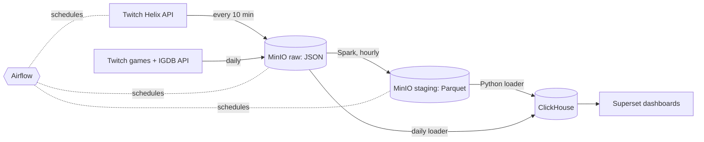
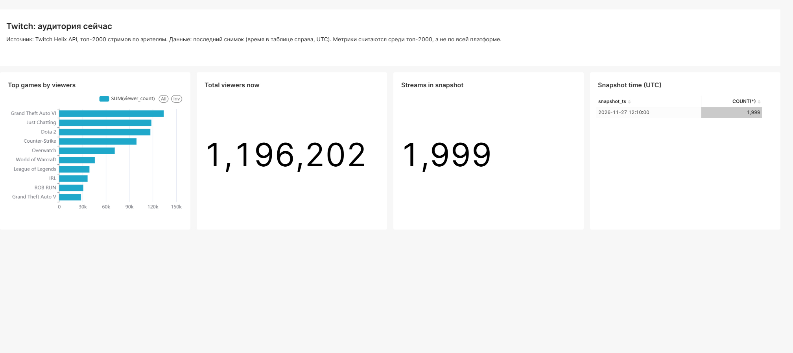
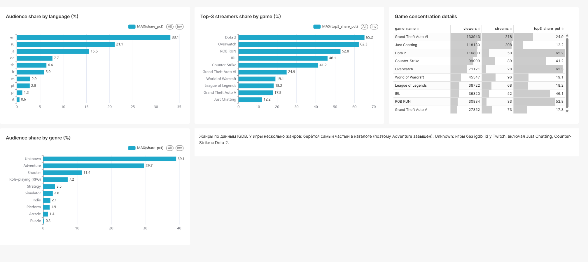

# Twitch streaming analytics pipeline

End-to-end data engineering project: collect live-stream snapshots from the Twitch API,
process them with Spark, store them in ClickHouse and explore them in Superset.
Everything runs locally in Docker and is orchestrated by Airflow.

## Architecture

| Layer | What it holds |
|---|---|
| `raw` | Untouched API responses, one JSON per snapshot (`raw/streams/dt=.../hour=.../`) |
| `staging` | Flattened, typed Parquet, partitioned by day (`rank`, dedup, "no category" label) |
| ClickHouse | `stream_snapshots` (fact table), `dim_games` (genres from IGDB), views `latest_snapshot` and `last_day` |

## Dashboards

Screenshots taken on 2026-11-27. Metrics are computed among the top-2000 streams.

### Twitch overview: current snapshot

### Audience structure: languages, concentration, genres

### Dashboard definitions
Dashboards, charts and datasets are exported to `superset/exports/` (one folder per dashboard),
so they live in Git, not only inside the Superset container volume.
SQL of the virtual datasets is also in `sql/05_superset_datasets.sql`.

To restore the dashboards:

1. Make sure ClickHouse has the tables and views (`sql/01_create_table.sql`, `03_views.sql`, `04_dim_games.sql`)
   and data (run the Airflow DAGs).
2. Build the zip files: `.\scripts\pack_superset_exports.ps1` (creates `superset/dist/*.zip`).
3. In Superset: Dashboards, Import, upload the zips one by one (`twitch_overview` first)
   and enter the ClickHouse password when asked (it is masked in the export).

Import was verified on a clean Superset instance (2026-11-28). To get one:
`docker compose --profile bi-test up -d superset-test` (http://localhost:8089, admin / admin123,
throwaway container without a volume).

Before committing anything, run `.\scripts\check_secrets.ps1` from the project root.

## Stack

Docker Compose, MinIO (S3), Spark 3.5.3, Airflow 3.4.0 (LocalExecutor), ClickHouse 26.10.4.207, Superset, Python 3.12.

## Airflow DAGs

| DAG | Schedule | Does |
|---|---|---|
| `ingest_streams` | every 10 min | Top-2000 streams snapshot into `raw` |
| `staging_and_load` | hourly at :15 | Spark `raw` to `staging` (last 2 days), then load into ClickHouse |
| `dim_games` | daily 06:00 UTC | Games and IGDB genres into `raw`, then rebuild `dim_games` |

## Design decisions

- **Raw is never modified.** Any downstream logic can be recomputed from it.
- **Idempotent steps.** Spark overwrites whole day partitions; the ClickHouse loader inserts only snapshots that are not there yet. Re-runs create no duplicates.
- **All timestamps are UTC.**
- **`rank` is stored explicitly.** Twitch order is not strictly sorted by viewers, so it cannot be restored from the table.
- **Hourly job reprocesses 2 days** so snapshots near midnight and missed runs are picked up automatically.

## Limitations

- Metrics describe the **top 2000 streams**, not the whole platform.
- Genres come from IGDB only where Twitch provides `igdb_id`: about 70% of viewers. The rest is `Unknown`
  (for example Just Chatting). A game with several genres is counted under its most common one in the catalog.
- Data is collected only while the machine and Docker are running, so gaps are possible.
- Local learning setup: default passwords in `docker-compose.yml` (Airflow, Postgres) must not be used anywhere else.
- Official MinIO images are no longer published, so a pinned community mirror (`dappros/minio`) is used.

## Run it

1. Copy `.env.example` to `.env` and fill in your Twitch app credentials
   (create an app at https://dev.twitch.tv/console, Client Type: Confidential).
2. Start storage: `docker compose up -d`, then create the bucket `twitch-data` in the MinIO console (http://localhost:9001).
3. Create ClickHouse objects: run `sql/01_create_table.sql`, `sql/03_views.sql`, `sql/04_dim_games.sql`
   (for example `Get-Content sql\01_create_table.sql | docker exec -i clickhouse clickhouse-client --user default --password <password> --multiquery`).
4. Airflow: `docker build -f docker/Dockerfile.airflow -t twitch-airflow:local .`, then
   `docker compose --profile airflow up airflow-init` and `docker compose --profile airflow up -d`.
   UI: http://localhost:8080. Enable the three DAGs.
5. Superset (optional): `docker compose --profile bi build superset`, initialize it
   (`db upgrade`, `fab create-admin`, `init`), start with `docker compose --profile bi up -d superset`, UI: http://localhost:8088.
   Connect ClickHouse (host `clickhouse`, port 8123, database `twitch`).